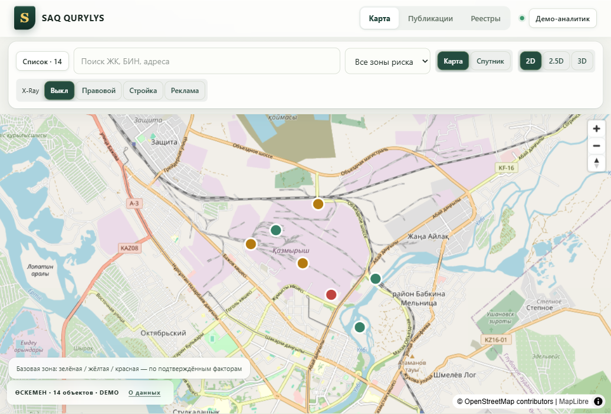

<div align="center">

# SAQ QURYLYS

**Долевое строительство, разобранное по фактам: от рекламы — к решению, которое можно проверить.**

Карта объектов · анализ материалов · объяснимый риск · история решений

[Живое DEMO](https://saq-qurylys-pi.vercel.app) · [Быстрый старт](#быстрый-старт) · [Документация](docs/README.md) · [Сообщить об ошибке](https://github.com/archexis/codemasters8/issues/new/choose)

[](LICENSE)
[](https://github.com/archexis/codemasters8/actions/workflows/ci.yml)


</div>



<sub>Карта опубликованной DEMO-сборки от 19 октября 2026 года. Интерфейс и состав набора могут отличаться в последующих версиях.</sub>

## Что делает проект

Реклама обещает, документы молчат, наблюдения разрознены. SAQ QURYLYS сводит их в одно досье по объектам долевого строительства в Казахстане — и ведёт материал через честную цепочку: извлечённое утверждение, решение человека, расчёт риска, сохранённая версия заключения с источниками. Ничего не подтверждается само: каждый балл надо заслужить первичным материалом.

| Возможность | Как используется |
| --- | --- |
| Карта и поиск | Найти объект по названию, адресу или БИН; отфильтровать риски; открыть досье |
| Публикации | Сохранить оригинал, выделить цитаты и разобрать гипотезы R2/R3 |
| Единое досье | Просмотреть сведения, проверку, связи и хронологию объекта |
| Расследование | Проверить факты в отдельном деле с материалами, периодом и обоснованием |
| Объяснимый score | Увидеть вклад каждого подтверждённого фактора |
| Версии и PDF | Зафиксировать решение и вернуться к его исходным данным после пересмотра |
| Резервная копия | Выгрузить ZIP с данными, файлами и контрольными суммами |

> Оценка риска помогает расставлять приоритеты проверки и не устанавливает факт правонарушения. Принятие AI-гипотезы само по себе не начисляет баллы. Отсутствие подтверждённых факторов не доказывает безопасность объекта.

## Быстрый старт

Нужны **Node.js 24** и npm. Python, Docker и учётная запись Supabase для DEMO не требуются.

```sh
git clone https://github.com/archexis/codemasters8.git
cd codemasters8
npm ci
npm run dev -- --port 5173 --strictPort
```

Откройте [127.0.0.1:5173](http://127.0.0.1:5173). Без заполненных `VITE_SUPABASE_URL` и `VITE_SUPABASE_ANON_KEY` включается DEMO без регистрации. Если эти переменные уже заданы в окружении или `.env*`, очистите обе и перезапустите Vite.

Начните с карты, откройте объект и перейдите к проверке. Полный путь от новой публикации до PDF описан в [сценарии демонстрации](docs/DEMO_SCRIPT.md).

## DEMO и подключённый режим

| | DEMO | Подключённый режим |
| --- | --- | --- |
| Вход | Без регистрации | Учётная запись Supabase Auth |
| Данные | Локальный демонстрационный набор | Персональное пространство в PostgreSQL с RLS |
| Файлы | IndexedDB браузера | Приватный Supabase Storage |
| Разбор текста | Локальный parser RU/KZ | Внешняя LLM через Edge Function |
| PDF | Печать в браузере | Печать и серверный PDF через FastAPI |
| Установка | Node.js и npm | Дополнительно Python; Docker для локального Supabase |

В DEMO решения хранятся в localStorage, вложения — в IndexedDB. Используйте один origin и профиль браузера; очистка данных браузера удаляет локальную работу. Сброс доступен в меню «Демо-аналитик». Для локальных записей требуется Web Locks API.

Демонстрационные сценарии содержат вымышленные сведения. Географический источник или датированный публичный снимок не подтверждает юридический статус объекта. Учитывайте происхождение и дату конкретной записи.

Публичная ссылка ведёт на DEMO с локальным parser. Для подключения Auth, БД, серверного PDF, OCR и внешней LLM следуйте [руководству по запуску](docs/RELEASE_RUNBOOK.md).

## Как считается риск

Score — сумма **уникальных подтверждённых** факторов, максимум 100. Непроверенные и отклонённые факторы баллов не дают.

| Код | Фактор | Вес |
| --- | --- | ---: |
| R1 | Отсутствие применимого законного основания | 35 |
| R2 | Прямое предложение внести деньги | 25 |
| R3 | Активная реклама строящегося жилья | 10 |
| R4 | Коллективное обращение | 15 |
| R5 | Разрыв готовности ≥ 20 процентных пунктов | 10 |
| R6 | Простой или просрочка | 5 |

Красная зона требует score ≥ 60 **и** подтверждения R1 и R2. Иначе score ≥ 25 означает жёлтую зону; меньший score — зелёную. Новое дело начинает собственную проверку. AI извлекает кандидатов R2/R3 с точными цитатами; факты подтверждает человек по первичным материалам.

Правила реализованы в [scoring.ts](src/lib/scoring.ts); границы доверия и сохранение истории описаны в [архитектуре](docs/ARCHITECTURE.md).

## Соответствие ТЗ

[Реализованные требования и дополнительные возможности](docs/REQUIREMENTS_COVERAGE.md).

## Разработка и проверки

```sh
npm run check
npm test
npm run build
```

Для браузерных проверок установите Chromium: `npx playwright install chromium`, затем запустите `npm run test:e2e`. В Linux CI используется `npx playwright install --with-deps chromium`.

| Команда | Что проверяет |
| --- | --- |
| `npm run test:e2e` | DEMO-сценарии в desktop и mobile Chromium |
| `npm run test:cloud` | Подключённый интерфейс с HTTP mock |
| `npm run test:api` | FastAPI; нужны Python-зависимости |
| `npm run test:edge` | Edge Function; нужен Deno |
| `npm run test:local` | Настоящий локальный Supabase; нужна отдельная настройка |

[Все команды и диагностика](docs/DEVELOPMENT.md). Live-проверки и платные вызовы LLM запускаются отдельно. Старые отчёты приёмки не означают, что текущий код прошёл новый прогон.

## Устройство репозитория

```text
src/                     Svelte-интерфейс и TypeScript-логика
backend/                 FastAPI, PDF, извлечение текста и OCR
supabase/functions/      Edge Function анализа публикаций
supabase/migrations/     Схема, RLS и серверные команды
tests/                   Unit, E2E, HTTP mock и live-проверки
tools/                   Проверки и вспомогательные скрипты
docs/                    Руководства и указатель архива
.github/                 CI и шаблоны задач и pull request
```

Стек: **Svelte 5 · TypeScript · Vite · Tailwind CSS · MapLibre · Supabase · FastAPI**. Точные зависимости зафиксированы в `package-lock.json` и `backend/requirements.lock.txt`. Рабочая точка входа — `src/main.ts`.

## Ограничения

- Автоматической сверки с государственными реестрами и скрейпинга источников нет.
- OCR доступен через сервер с Tesseract; распознанный текст требует сверки с оригиналом.
- Анализа готовности по фото или дрон-видео с помощью CV нет. Картографические модели и недатированные подложки не являются доказательствами.
- Карта зависит от внешних тайлов и возможностей браузера; предусмотрены упрощённое отображение и список объектов.
- Подключённые данные изолированы по пользователю. Общие пространства организаций и полный двуязычный интерфейс пока не реализованы.

## Документация и участие

[Документация](docs/README.md) · [Запуск и эксплуатация](docs/RELEASE_RUNBOOK.md) · [Архитектура](docs/ARCHITECTURE.md) · [Вклад в проект](CONTRIBUTING.md) · [Безопасность](SECURITY.md)

Код распространяется по лицензии [MIT](LICENSE).
