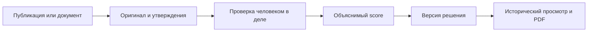

# Архитектура и данные

## Основной поток

Материал, AI-гипотеза и подтверждённый факт — разные сущности. Решение по гипотезе не подтверждает факт и не увеличивает score. У дела собственные проверенные утверждения, область объекта или очереди и, при наличии, период применимости.

## Компоненты

| Слой | Основные файлы | Ответственность |
| --- | --- | --- |
| Интерфейс | `src/App.svelte`, `src/components/` | Карта, публикации, реестры, досье и расследование |
| Маршруты | `src/lib/navigation.ts` | Hash-навигация, вкладки и совместимость ссылок |
| Домен | `src/lib/domain.ts`, `investigation.ts`, `validation.ts` | Команды, переходы состояний, проверки входа |
| Скоринг | `src/lib/scoring.ts` | Веса R1–R6, дедупликация факторов и зоны |
| Хранилище клиента | `src/lib/repository.ts` | DEMO, подключённые команды, версии и повторы |
| Анализ | `src/lib/analysis.ts`, `supabase/functions/analyze/` | Parser или доверенный серверный AI-run |
| База | `supabase/migrations/` | PostgreSQL JSONB workspace, RLS, RPC и история |
| API | `backend/app/main.py`, `projections.py` | Авторизованные проекции и операции с документами |
| PDF и OCR | `backend/app/pdf.py`, `ocr.py`, `document_jobs.py` | PDF по snapshot, извлечение текста и очередь обработки |

Точки входа: `index.html` → `src/main.ts` → `src/App.svelte`. `js/` и `css/` относятся к раннему прототипу и сохраняются в том числе для регрессионных фикстур.

## Хранение и команды

В DEMO состояние хранится в localStorage, байты файлов — в IndexedDB. Web Locks сериализует локальную запись; если API недоступен, приложение блокирует запись. Данные привязаны к origin и профилю браузера.

В подключённом режиме Supabase Auth определяет пользователя, RLS ограничивает его workspace и файлы. Основное состояние хранится как JSONB в `workspaces`. Команды проходят через `apply_command(command, expected_version, command_id)`: сервер проверяет вход, версию и повтор команды. Квитанция позволяет повторить запрос после неизвестного сетевого результата. Reviewer и время решения назначаются сервером.

FastAPI проверяет Bearer JWT через Supabase Auth и обращается к PostgREST/Storage с токеном пользователя. Service role ему не требуется. Ограниченные read endpoints уже есть, но сервер по-прежнему читает JSONB workspace; отдельные индексированные таблицы всех предметных сущностей пока не выделены. Не все экраны переведены на удалённые представления с курсорами.

## AI и проверка фактов

DEMO использует RU/KZ parser. Подключённый AI работает через Edge Function `analyze` и OpenAI-compatible chat completions provider. Ключ провайдера хранится на сервере. Ошибка провайдера не подменяется успешным parser-результатом в подключённом AI-запуске.

Результат ограничен кандидатами R2/R3: до шести гипотез с точной цитатой из входного текста. Сохраняются ID запуска, исходный snapshot, его хеш и версии prompt/schema. Импортированные результаты требуют повторной проверки. R1/R4/R5/R6 требуют других первичных материалов и ручного решения.

Лимиты анализа: 20 000 JS-символов текста, 100 000 байт тела запроса, 30 запросов в час на пользователя; timeout провайдера — 30 секунд. Сервер проверяет принадлежность и успешность AI-run. Клиентская валидация дополняет серверную.

## Скоринг и область решения

Веса: R1=35, R2=25, R3=10, R4=15, R5=10, R6=5. Каждый подтверждённый код учитывается один раз. Красная зона: score ≥ 60 и подтверждены R1/R2; иначе жёлтая при score ≥ 25, зелёная ниже 25. Нет данных об основании — не подтверждение R1; score 0 — не заключение о безопасности.

Готовность очереди не наследует готовность всего ЖК автоматически. Для R5 нужны два сопоставимых значения с источниками и датами. Проверки применимости учитывают известный период дела и материалов. Контекстная связь объектов, организаций или аккаунтов проверяется отдельно и сама по себе не начисляет баллы.

Правила зеркалируются в TypeScript, SQL и Python. При изменении весов согласуйте версию правил, snapshot, SQL builder, API и тестовые контракты.

## История и файлы

Подтверждённое решение создаёт неизменяемую версию со сведениями об объекте, области, фактах, источниках и manifest файлов. Пересмотр меняет текущую работу; прежняя версия и PDF используют сохранённый snapshot.

Private Storage принимает JPEG/PNG/WebP/MP4/PDF до 20 MiB с пользовательским префиксом. Доступ выдаётся подписанной ссылкой. Материал со ссылкой из доказательства нельзя удалить обычной командой. Ограничение MIME не заменяет проверку содержимого.

PDF extraction возвращает непроверенный текст по страницам. OCR использует Tesseract `rus+eng`; без него доступен ручной ввод. OCR PDF обрабатывает встроенные растровые изображения с ограничениями по объёму и времени. Worker работает в процессе FastAPI, а незавершённые задания после перезапуска требуют авторизованного retry; отдельного брокера очередей нет.

## Backup

Полная прикладная копия — ZIP с JSON, байтами файлов и SHA256 manifest. `GET /api/export` возвращает только JSON. Restore выполняется в отдельное пустое пространство: импортированные факты требуют повторной проверки, активные решения возвращаются в черновик; исходная атрибуция остаётся provenance.

Backup приложения не заменяет инфраструктурные копии PostgreSQL и Storage. Порядок обновления и восстановления — в [руководстве по эксплуатации](RELEASE_RUNBOOK.md).
